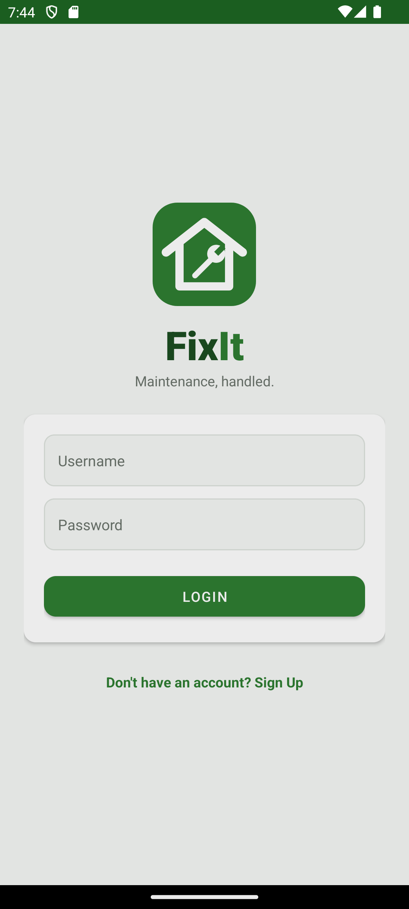
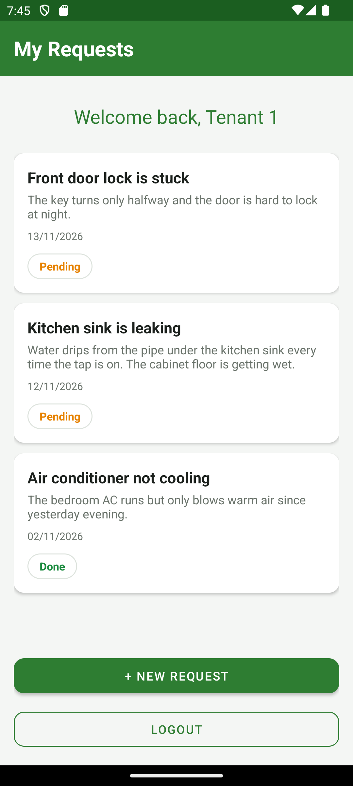
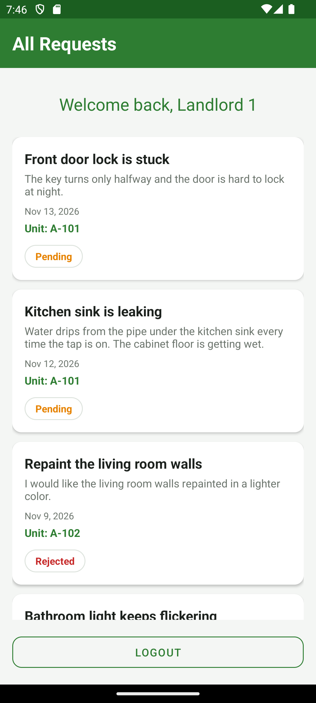
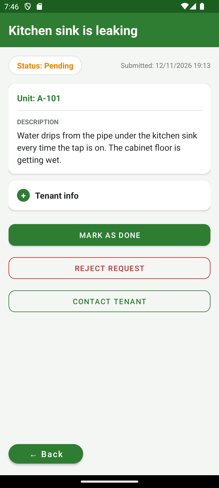

# FixIt — Landlord–Tenant Maintenance App

*Maintenance, handled.*

FixIt is an Android app (Java, XML, Room/SQLite) where tenants submit maintenance
requests and their landlord tracks, completes or rejects them.

| Login | Tenant home | Landlord home | Request detail |
|---|---|---|---|
|  |  |  |  |

## Features

**Tenants**
- Sign up as a tenant with a unit number and the username of their landlord.
- Submit maintenance requests (title + description) and see their own requests with a status badge.
- Edit or delete a request while it is **Pending**.
- See why a request was **Rejected** by tapping it.

**Landlords**
- See only the requests from their own tenants, Pending first, with each tenant's unit.
- Open a request to see the details and the tenant's name, unit and email.
- Mark a request **Done**, or **Reject** it by ticking reasons from a checklist, and reopen it later.
- Contact the tenant by email from the request.
- Get a notification when a new request is submitted.

**Everyone**
- Password rule at sign up: must start with a letter and have at least 4 letters and 3 numbers.
- Welcome message with the user's name, green title bars, and Back buttons on inner screens.

## Demo accounts

Created automatically on first launch, when the database is empty.

| Role | Username | Password | Unit | Landlord |
|---|---|---|---|---|
| Landlord | `landlord1` | `landlord123` | | |
| Landlord | `landlord2` | `landlord123` | | |
| Tenant | `tenant1` | `tenant123` | A-101 | landlord1 |
| Tenant | `tenant2` | `tenant123` | A-102 | landlord1 |
| Tenant | `tenant3` | `tenant123` | B-201 | landlord2 |

The demo data also includes eight requests (Pending, Done and Rejected).

## Run it

1. Install [Android Studio](https://developer.android.com/studio) and open this folder.
2. Let Gradle sync, pick an emulator, press **Run**.

Step-by-step instructions are in [docs/GETTING_STARTED.pdf](docs/GETTING_STARTED.pdf).

## Documentation

| File | What it is |
|---|---|
| [docs/PROJECT_DOCUMENTATION.pdf](docs/PROJECT_DOCUMENTATION.pdf) | Full documentation: screens, features, data model, architecture, rules, test plan |
| [docs/GETTING_STARTED.pdf](docs/GETTING_STARTED.pdf) | Clone, open, run and push |
| [docs/PERSON1_LOGIN_WORK.pdf](docs/PERSON1_LOGIN_WORK.pdf) | Login screen: layout and full source |
| [docs/CHECKLISTS_ALL_STUDENTS.pdf](docs/CHECKLISTS_ALL_STUDENTS.pdf) | One checklist page per team member |

Word (`.docx`) versions of each are in the same folder.

## Project structure

```
app/src/main/
  java/com/fixit/app/
    LoginActivity, SignupActivity            sign in / create account
    TenantHomeActivity, NewRequestActivity   tenant screens (list, create/edit/delete)
    LandlordHomeActivity, RequestDetailActivity   landlord screens (list, detail/reject/done)
    RequestAdapter                           tenant request rows
    NewRequestReceiver                       broadcast receiver + notification
    User, UserDao, Request, RequestDao       Room entities and DAOs
    AppDatabase                              Room database (fixit_db, version 3)
  res/layout/   one XML layout per screen + item_request.xml (list row)
  res/values/   colors.xml, themes.xml (shared styles), strings.xml
  res/drawable/ logo, input and badge backgrounds
```

## Data model

- **users**: `user_id`, `name`, `username` (unique), `password`, `email`, `role` (`tenant` / `landlord`), `unit_number`, `landlord_id` (tenants only).
- **requests**: `request_id`, `tenant_id`, `title`, `description`, `status` (`Pending` / `Done` / `Rejected`), `created_at`, `reject_reasons`.

## Team and workflow

Six students, one branch (`main`), each owning their own files. Use `git pull --rebase`
before every push. The file split:

| Person | Screen | Files |
|---|---|---|
| 1 | Login | `LoginActivity`, `activity_login.xml`, `User`, `UserDao` |
| 2 | Sign Up | `SignupActivity`, `activity_signup.xml`, `AppDatabase`, `build.gradle` |
| 3 | Tenant Home | `TenantHomeActivity`, `activity_tenant_home.xml`, `RequestAdapter`, `item_request.xml` |
| 4 | New Request | `NewRequestActivity`, `activity_new_request.xml`, `Request`, `RequestDao` |
| 5 | Landlord Home | `LandlordHomeActivity`, `activity_landlord_home.xml`, `NewRequestReceiver` |
| 6 | Request Detail | `RequestDetailActivity`, `activity_request_detail.xml`, `AndroidManifest.xml`, testing |

## Known limitations

- Passwords are stored as plain text (school project; hashing is the obvious next step).
- The new-request notification goes to whichever landlord is logged in on the device, not only the tenant's landlord.
- There are no automated tests; use the manual test plan in the project documentation.
